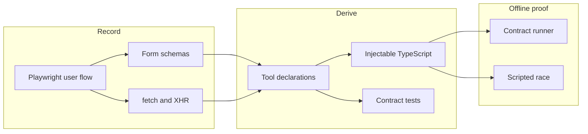
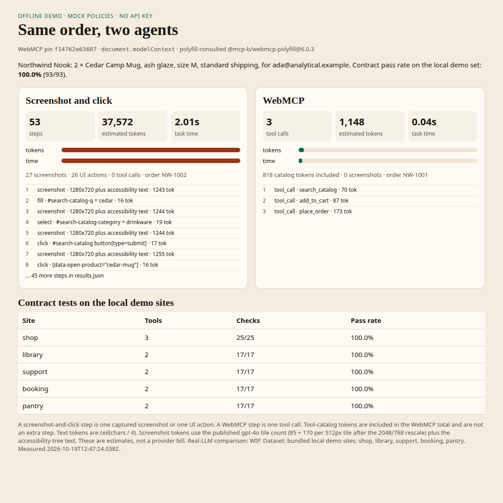
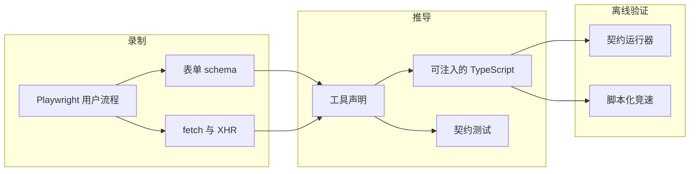

# WebMCP Retrofit

Record one real pass through a website. Turn the forms and the `fetch` / XHR calls from that pass into [WebMCP](https://github.com/webmachinelearning/webmcp) tools an agent can call, then check that those tools still do what the recording did.

A screenshot-and-click agent pays for every pixel. A page that publishes tools can place the same order in a handful of calls. This repo measures that gap on local demo sites, with scripted policies and no API key.

## The pain

Agents still drive the web by looking at screenshots and clicking. That is slow, brittle, and expensive in tokens. The project brief for this repo cites four public signals:

- [Guillermo Rauch on WebMCP](https://x.com/rauchg/status/2096065378598441431) (1,570 likes in that brief)
- The spec repository [webmachinelearning/webmcp](https://github.com/webmachinelearning/webmcp) (cited there at 4.7k stars; the GitHub page fetched while pinning this build on 2026-10-19 showed 4,586 stars)
- [The overhead of screenshot-and-click](https://x.com/fsb0804/status/2097141951191527716) (1 like in that brief)
- [Agents that cannot read the page](https://x.com/nereasolenne/status/2098091484717134001) (81 likes in that brief)

Existing work is a benchmark, a DevTools inspector, or a generator with no check that the generated tools still hit the site. Retrofit records a Playwright flow, derives `document.modelContext` tools and handlers, and generates contract tests that run the handlers against the live page.

## Pinned WebMCP surface

Checked on 2026-10-19 against [webmachinelearning/webmcp](https://github.com/webmachinelearning/webmcp) commit [`f14762e63607bf96592b1a7a6392cd2b047b8209`](https://github.com/webmachinelearning/webmcp/commit/f14762e63607bf96592b1a7a6392cd2b047b8209) (2026-10-16, “Editorial: sync explainers with spec”).

Generated snippets call `document.modelContext.registerTool`, `getTools`, and `executeTool`, and they unregister with `AbortSignal`. The same surface is described by the [Chrome imperative API docs](https://developer.chrome.com/docs/ai/webmcp/imperative-api), last updated 2026-10-16. Behavior was checked against `@mcp-b/webmcp-polyfill` 6.0.3, which vendors upstream revision `6bf6c57bbaf3d1173d7737cfb79572632d9b7871`. That package is not copied. The offline demo ships an original subset polyfill because headless Chromium in this run has no native `modelContext`.

`navigator.modelContext` is the earlier name. The pinned polyfill does not install that alias, and these snippets do not assign it. `provideContext` / `clearContext` were removed in [spec PR 132](https://github.com/webmachinelearning/webmcp/pull/132) (merged 2026-03-05) and are not emitted. The spec is still moving. This commit is the pin.

## Architecture



Playwright drives a real browser through each demo site. After every action it snapshots named form controls (type, required, label, options) and records API calls, including whether the page used `fetch` or `XMLHttpRequest`. Each successful `/api/` call becomes one tool: a JSON Schema from the form, annotations (`readOnlyHint` on GET, `consequentialHint` on checkout-style POSTs), and an `execute` handler that fills that form and submits it so the page’s own client code runs. The handler is emitted as TypeScript (`generated/<site>/inject.ts`) and bundled to an injectable script. Contract tests load the script, call `document.modelContext.executeTool` with the recorded example, and assert the schema, the network call, and the DOM outcome.

## Quickstart

Requires Node.js 22 or newer. No API key.

```bash
npm install
npx playwright install chromium
npm test
```

`npm test` records all five local sites, writes `generated/`, runs the contract checks, races the shop order, and refreshes `docs/results.json` plus `docs/race-report.html`. Timings move a little between machines. The table below is the run stored in `docs/results.json`.

```bash
npm run demo          # same pipeline, prints the summary
npm run serve -- shop # open the printed localhost URL
npm run test:contracts
```

`npm run serve` stays up until you stop it. The shop, library, support desk, clinic, and kitchen are all local. Nothing in the demo calls a model.

## Offline race

Both agents place the same Northwind Nook order: 2 × Cedar Camp Mug (`cedar-mug`), size M, ash glaze, standard shipping, for `ada@analytical.example`. The screenshot agent is a fixed observe-then-act script. It captures a PNG and an accessibility snapshot before every click, fill, or select. The WebMCP agent only calls the three tools derived from that same recording: `search_catalog`, `add_to_cart`, `place_order`. They run at the same time in two browser pages. Neither policy is a language model.



## Measured results

Dataset: the five bundled local demo sites in this repository (Northwind Nook, Harbor Library, Lumen Desk, Cedar Clinic, Weeknight Pantry). Race subset: the shop order above. Measured at `2026-10-19T12:47:24.038Z` in the run recorded by `docs/results.json`. Real-LLM comparison: **WIP**.

| Site | Derived tools | Contract checks | Pass rate |
| --- | --- | --- | --- |
| shop | 3 | 25/25 | 100% |
| library | 2 | 17/17 | 100% |
| support | 2 | 17/17 | 100% |
| booking | 2 | 17/17 | 100% |
| pantry | 2 | 17/17 | 100% |
| **All five** | **11** | **93/93** | **100%** |

| Agent | Steps | Tool calls | Screenshots | UI actions | Estimated tokens | Task time |
| --- | --- | --- | --- | --- | --- | --- |
| Screenshot and click | 53 | 0 | 27 | 26 | 37,572 | 2,014 ms |
| WebMCP | 3 | 3 | 0 | 0 | 1,148 | 35 ms |

Both orders confirmed `sku=cedar-mug`, `qty=2`, `shipping=standard`, `total=60`. The WebMCP tool result and the DOM confirmation were the same order id. The two agents received different ids (`NW-1001` and `NW-1002`) because they checked out concurrently.

Of the WebMCP token estimate, 818 are the tool catalog charged once and 330 are the three calls’ arguments and results. From these cells, the click agent’s estimate is 37,572 / 1,148 ≈ 32.7 times the WebMCP estimate, and its task took 2,014 / 35 ≈ 57.5 times as long.

Counting rule, also stored in `docs/results.json`: a screenshot-and-click step is one captured screenshot or one UI action. A WebMCP step is one tool call. Text tokens are `ceil(chars / 4)`. Image tokens use the published gpt-4o tile count (fit inside 2048 px, shortest side at most 768 px, then 85 + 170 per 512 px tile) plus the accessibility-tree text. These are estimates for the race, not a provider bill. Task time is local browser work. The click agent’s time includes PNG capture. Neither time includes model inference, because no model was called.

## Limits

- The pin above will go stale. Regenerate against a newer spec commit before trusting the snippets on a moving browser.
- The local polyfill rejects non-empty `exposedTo` and `fromOrigins`. Cross-origin tools need a native implementation.
- A tool is derived only when a recorded action submits a form whose fields cover an `/api/` call. A click that never leaves the page does not become a tool.
- The agents are mock policies used to verify the pipeline. A comparison against a real model is WIP.
- Pass rate here is on five fixtures we authored, not on the public web.

## License

Apache-2.0. See `LICENSE` and `NOTICE`.

---

# WebMCP Retrofit（中文）

录一次真实的网页操作，把这次操作里的表单和 `fetch` / XHR 调用变成智能体可以直接调用的 [WebMCP](https://github.com/webmachinelearning/webmcp) 工具，再验证这些工具是否仍然完成录制时的那件事。

截图再点击的智能体要为每个像素付钱。页面如果直接公布工具，同一笔订单只要几次调用。这个仓库在本地演示站上测量这个差距。策略是写死的脚本，不需要 API key。

## 痛点

智能体现在仍然靠看截图、点按钮来操作网页。慢，容易碎，token 也贵。本仓库的立项说明引用了四条公开材料：

- [Guillermo Rauch 谈 WebMCP](https://x.com/rauchg/status/2096065378598441431)（该说明里记录为 1,570 个赞）
- 规范仓库 [webmachinelearning/webmcp](https://github.com/webmachinelearning/webmcp)（该说明里写的是 4.7k star；2026-10-19 为本次钉版本而打开的 GitHub 页面显示 4,586 star）
- [截图点击的额外开销](https://x.com/fsb0804/status/2097141951191527716)（该说明里记录为 1 个赞）
- [智能体看不懂网页](https://x.com/nereasolenne/status/2098091484717134001)（该说明里记录为 81 个赞）

已经有的东西要么是基准测试，要么是 DevTools 检查器，要么是一个生成器，但没有人验证生成出来的工具是否真的还能打到网站。Retrofit 用 Playwright 录流程，推导 `document.modelContext` 的工具和处理函数，再生成契约测试，让处理函数在真实页面上跑一遍。

## 钉住的 WebMCP 表面

2026-10-19 核对的是 [webmachinelearning/webmcp](https://github.com/webmachinelearning/webmcp) 提交 [`f14762e63607bf96592b1a7a6392cd2b047b8209`](https://github.com/webmachinelearning/webmcp/commit/f14762e63607bf96592b1a7a6392cd2b047b8209)（2026-10-16，“Editorial: sync explainers with spec”）。

生成的片段调用 `document.modelContext.registerTool`、`getTools` 和 `executeTool`，并用 `AbortSignal` 取消注册。同一表面也写在 [Chrome 命令式 API 文档](https://developer.chrome.com/docs/ai/webmcp/imperative-api)里，该页最后更新于 2026-10-16。行为对照过 `@mcp-b/webmcp-polyfill` 6.0.3，它内含上游修订 `6bf6c57bbaf3d1173d7737cfb79572632d9b7871`。这里没有复制那个包。这次运行的无头 Chromium 没有原生 `modelContext`，所以离线演示带了一份自己写的子集 polyfill。

`navigator.modelContext` 是更早的名字。钉住的 polyfill 不会安装这个别名，这些片段也不会去赋值。`provideContext` / `clearContext` 已在[规范 PR 132](https://github.com/webmachinelearning/webmcp/pull/132)（2026-03-05 合并）里删除，不会生成。规范还在变。上面的提交就是本次钉住的版本。

## 架构



Playwright 在真实浏览器里走完每个演示站。每一步之后，它快照具名表单控件（类型、是否必填、标签、选项），并记录 API 调用，包括页面用的是 `fetch` 还是 `XMLHttpRequest`。每一次成功的 `/api/` 调用变成一个工具：schema 来自表单，注解里 GET 标 `readOnlyHint`、结账一类的 POST 标 `consequentialHint`，`execute` 处理函数把那个表单填上再提交，从而跑的是页面自己的客户端代码。处理函数输出成 TypeScript（`generated/<site>/inject.ts`），再打包成可注入脚本。契约测试加载脚本，用录制时的示例调用 `document.modelContext.executeTool`，然后断言 schema、网络请求和 DOM 结果。

## 快速开始

需要 Node.js 22 或更新版本。不需要 API key。

```bash
npm install
npx playwright install chromium
npm test
```

`npm test` 会录制全部五个本地站点，写下 `generated/`，跑契约检查，对商店订单做竞速，并刷新 `docs/results.json` 和 `docs/race-report.html`。不同机器上的耗时会有一点出入。下面的表是 `docs/results.json` 里这一次运行的数字。

```bash
npm run demo          # 同一条流水线，并打印摘要
npm run serve -- shop # 打开打印出来的 localhost 地址
npm run test:contracts
```

`npm run serve` 会一直跑到你停掉它。商店、图书馆、工单台、诊所和厨房都在本机。演示不会调用任何模型。

## 离线竞速

两个智能体下同一笔 Northwind Nook 订单：2 个 Cedar Camp Mug（`cedar-mug`），尺码 M，釉色 ash，标准配送，收件人 `ada@analytical.example`。截图智能体是固定的“先观察再动作”脚本，每次点击、填写或选择之前都抓一张 PNG 和一份无障碍树快照。WebMCP 智能体只调用从同一次录制推导出的三个工具：`search_catalog`、`add_to_cart`、`place_order`。它们在两个浏览器页面里同时跑。两边都不是语言模型。


## 实测结果

数据集：本仓库里的五个本地演示站（Northwind Nook、Harbor Library、Lumen Desk、Cedar Clinic、Weeknight Pantry）。竞速只用上面那笔商店订单。测量时间 `2026-10-19T12:47:24.038Z`，记录在 `docs/results.json`。真实 LLM 对比：**WIP**。

| 站点 | 推导出的工具 | 契约检查 | 通过率 |
| --- | --- | --- | --- |
| shop | 3 | 25/25 | 100% |
| library | 2 | 17/17 | 100% |
| support | 2 | 17/17 | 100% |
| booking | 2 | 17/17 | 100% |
| pantry | 2 | 17/17 | 100% |
| **五个合计** | **11** | **93/93** | **100%** |

| 智能体 | 步数 | 工具调用 | 截图 | 界面动作 | 估计 token | 任务耗时 |
| --- | --- | --- | --- | --- | --- | --- |
| 截图并点击 | 53 | 0 | 27 | 26 | 37,572 | 2,014 ms |
| WebMCP | 3 | 3 | 0 | 0 | 1,148 | 35 ms |

两笔订单都确认了 `sku=cedar-mug`、`qty=2`、`shipping=standard`、`total=60`。WebMCP 的工具返回值和 DOM 上的确认是同一个订单号。因为两边同时结账，订单号不同（`NW-1001` 和 `NW-1002`）。

WebMCP 的 token 估计里，818 是一次性计入的工具目录，330 是三次调用的参数和结果。按上表计算，点击智能体的估计是 WebMCP 的 37,572 / 1,148 ≈ 32.7 倍，任务耗时是 2,014 / 35 ≈ 57.5 倍。

计数规则也写在 `docs/results.json` 里：截图点击的一步，要么是一张截图，要么是一个界面动作。WebMCP 的一步是一次工具调用。文本 token 用 `ceil(字符数 / 4)`。图像 token 用已公开的 gpt-4o 分块算法（先放进 2048 像素，短边最多 768 像素，然后每块 512 像素计 170，再加 85），再加上无障碍树文本。这些是竞速用的估计，不是供应商账单。任务耗时是本地浏览器里的工作。点击智能体的耗时包含 PNG 抓取。两边都没有模型推理时间，因为没有调用模型。

## 局限

- 上面的钉版本会过时。浏览器继续变的时候，先对更新的规范提交重新生成，再相信这些片段。
- 本地 polyfill 会拒绝非空的 `exposedTo` 和 `fromOrigins`。跨源工具需要原生实现。
- 只有当录制到的动作提交了一个表单，且表单字段盖住了某次 `/api/` 调用时，才会推导出工具。没有离开页面的点击不会变成工具。
- 这里的智能体是用来验证流水线的模拟策略。和真实模型的对比是 WIP。
- 这里的通过率来自我们写的五个夹具，不是公网网站的样本。

## 许可证

Apache-2.0。见 `LICENSE` 和 `NOTICE`。
